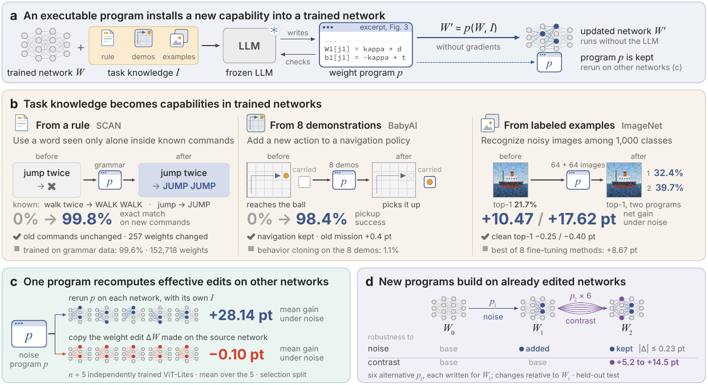

<h1 align="center">🧠 WeightCode</h1>

<h3 align="center">🧬 Installing New Capabilities into Neural Networks via Weight-Space Programming</h3>

<p align="center">
  <b>English</b> · <a href="README.zh-CN.md">简体中文</a>
</p>

<p align="center">
  <a href="#try-it"></a>
  <a href="#agent-skill"></a>
  <a href="assets/WeightCode.pdf"></a>
</p>

<p align="center">
  
  
  <a href="LICENSE"></a>
</p>

<p align="center">
  <a href="#what-we-achieved">🏆&nbsp;Results</a> ·
  <a href="#try-it">⚡&nbsp;Try&nbsp;it</a> ·
  <a href="#agent-skill">🧩&nbsp;Agent&nbsp;skill</a> ·
  <a href="#how-it-works">⚙️&nbsp;How&nbsp;it&nbsp;works</a> ·
  <a href="#quick-start">🚀&nbsp;More&nbsp;checks</a> ·
  <a href="#run-the-experiments">🔬&nbsp;Experiments</a> ·
  <a href="https://huggingface.co/datasets/Boom5426/WeightCode">🤗&nbsp;Data</a> ·
  <a href="#repository-map">🗂️&nbsp;Code&nbsp;map</a>
</p>

💡 **WeightCode installs new capabilities into trained neural networks without gradient training.** A frozen
language model writes an executable *weight program* that turns a rule, a few demonstrations or a few labeled
examples into new weights; the updated network runs on its own, and the program reruns on other networks.
🧩 It ships as an **agent skill**: ⚡ [copy the commands and run it ↓](#try-it)

<p align="center">
  <a href="assets/fig1.png"></a>
</p>

<a id="what-we-achieved"></a>

## 🏆 What we achieved

| | Finding | Key result |
| :--- | :--- | :--- |
| ✨ **Installation** | A rule, 8 demonstrations or 64 + 64 labeled images become a capability the network did not have, and its existing behavior stays. | SCAN **0% → 99.8%** · BabyAI **0% → 98.4%** |
| 🛡️ **Beyond fine-tuning** | Given the same examples, checks and clean-accuracy bound, programs exceed the best of 8 fine-tuning methods on ImageNet and CIFAR-10. | ImageNet noise **+10.47 / +17.62 pt** vs +8.67 |
| 🔬 **Mechanism** | The installed computation can be read and tested: removing its noise gates removes the gain. | net gain **+31.75 → +10.05 pt** without the main gate |
| ♻️ **Reuse** | Rerun without the LLM on 5 independently trained networks, a program writes a new edit for each; copying the weight edit does not. | **83–110%** of the gain kept · copied edit **−0.10 pt** |
| 🧱 **Succession** | New programs build on an already edited network and keep the earlier capability. | **+5.2 to +14.5 pt** added · earlier within **0.23 pt** |

📄 **[Read the paper](assets/WeightCode.pdf)** for the full comparisons, the mechanism analyses and every session.
🤗 **[Get the data on Hugging Face](https://huggingface.co/datasets/Boom5426/WeightCode)**.
📏 Net gain is the accuracy change on the new condition plus the change in clean accuracy, in percentage points (pt).
Mechanism and copied-edit numbers are on a held-out analysis split; the rest are on held-out test sets.

<a id="try-it"></a>
<a id="install"></a>

## ⚡ Try it: reproduce a paper result in about two minutes

🖥️ Needs **Linux x86-64** and [uv](https://docs.astral.sh/uv/). No GPU, no API key, no root and no sandbox setup.

```bash
git clone https://github.com/Gen-Verse/WeightCode.git && cd WeightCode
uv sync --locked
uv run weightcode reproduce scan
```

✅ This reruns, with no language model, the program that taught a SCAN sequence model to use "jump" inside commands
(Figure 1b, left), then reads both networks on the paper's held-out test commands. It ends with:

```text
  SCAN: a rule becomes a capability (Figure 1b, left)
  Exact match on held-out test commands      before    after
    new commands with 'jump' (2,568)          0.0%    99.8%
    old commands (1,000)                     99.6%    99.6%
  Weights changed: 257 of 803,975
  Rebuilt network identical to the published one: yes (sha256 6c9bc3bdaf34)
  Paper: +99.81 pt on new commands, +0.00 pt on old ones, 257 weights changed -> reproduced exactly
```

🔍 What it does:

- 📥 Downloads the trained network, the session record and the program (about 10 MB) from the
  [🤗 dataset](https://huggingface.co/datasets/Boom5426/WeightCode), and SCAN's text files from
  [its repository](https://github.com/brendenlake/SCAN) at the commit the paper used. Every file is checked by sha256.
- 🧱 Rebuilds the paper's test split from SCAN's files and checks that it is the one the paper read.
- ♻️ Reruns the program and checks that the edited network it builds is the published one, bit for bit.
- 📏 Reads the original and the edited network on 2,568 new and 1,000 old held-out commands.

🫧 The published program runs after its sha256 check, without the sandbox. Add
`--sandbox-python .venv-sandbox/bin/python` to run it inside bubblewrap ([setup](#install-the-skill)). Behind a
firewall, set `HF_ENDPOINT` to a Hugging Face mirror and pass `--scan-dir` with a local clone of SCAN.

<a id="try-imagenet"></a>

### 🖼️ ImageNet: noise robustness from 64 + 64 labeled images

🔑 Needs a Hugging Face account that has accepted the
[ImageNet-1k terms](https://huggingface.co/datasets/ILSVRC/imagenet-1k) and about 650 MB of downloads. It took about
five minutes on our 24-thread CPU.

```bash
uv sync --locked --extra train --extra t03
uv run hf auth login
uv run weightcode reproduce imagenet
```

✅ It reads torchvision's ImageNet ResNet-18 and the two networks that two programs built for it (Figure 1b, right) on
the first 500 held-out test images, clean and with Gaussian noise. It ends with:

```text
  ImageNet: 64 + 64 labeled images make a ResNet-18 robust to noise (Figure 1b, right)
  Top-1 accuracy on the first 500 held-out test images
                                              original   program 1   program 2
    with Gaussian noise (severity 3)             19.4%       33.2%       38.4%
    clean                                        69.6%       70.4%       70.2%
  Same correctness as the paper's record, image by image (3 networks x clean and noisy): 3,000 of 3,000
  Paper, all 38,000 test images: noise 21.66% -> 32.38% / 39.67%, clean 69.70% -> 69.45% / 69.30%, net gain +10.47 / +17.62 pt
  (500 images give a rougher estimate than the paper's 38,000; the image-by-image check shows they are read as the paper read them.)
```

🔍 What it does:

- 📥 Downloads the original network, the two edited networks and the paper's test record, which stores every image's
  correctness for every network. Each edited network must hash to the one in the record.
- 🖼️ Takes the first 500 of the 38,000 held-out test images in row order from ImageNet's validation set at the revision
  the paper used, crops them, and adds noise with ImageNet-C's official code, per-image seed and JPEG quality 85.
- 📏 Reads the three networks on the same clean and noisy images and checks each image's correctness against the
  record.

⚖️ The three networks see the same images, chosen by position, not by result. 500 images give a rougher estimate than
the paper's 38,000, and the image-by-image check shows they are read exactly as the paper read them.
`--images 38000` reads the whole test set (6.7 GB, several CPU hours). This example does not rerun the programs,
because the images they learned from are spread over the whole validation set. The SCAN example above shows a rerun.

<a id="agent-skill"></a>

## 🧩 The agent skill

🗣️ **Tell your coding agent what the network should learn. Get back a checked model, the program that built it, and a
report.** The [`weightcode` skill](skills/weightcode/SKILL.md) drives the whole workflow: it imports your checkpoint,
binds your data, reuses or writes a weight program in a sandbox, and releases an update only if it holds up on data
the program never saw.

| 📥 You bring | 🤖 The agent runs | 📦 You get |
| :--- | :--- | :--- |
| 🧠 An FP32 torchvision ResNet-18 `state_dict` and its class list<br>🗂️ Three disjoint image sets: *experience* (seen by the program), *selection* (scores candidates), *final* (validates once)<br>🎚️ The clean-accuracy loss you accept | 🔍 Compatibility check and import<br>♻️ **Reuse** an existing program, no language-model call<br>✍️ **Synthesize** a new one with the controlled editor (Claude Code, explicit budget)<br>🏆 A fixed selection rule, then one final validation | 🧠 `model.pt`: the updated model if `accepted`, the original otherwise<br>📝 The program bundle, rerunnable on other checkpoints<br>📋 `report.json`: `accepted`, `base-kept` or `final-rejected` |

<a id="install-the-skill"></a>

### 🛠️ Install the skill

🫧 The skill runs every program, including the ones a language model writes for you, in a
[bubblewrap](https://github.com/containers/bubblewrap) sandbox with no network and no view of your selection and final
data. It needs **Linux x86-64** and **bubblewrap 0.8+** (Ubuntu 24.04+, Debian 12+: `sudo apt install bubblewrap`).
Ubuntu 22.04 ships 0.6: build a newer one without root with `bash scripts/build_bwrap.sh`, then export the
`WEIGHTCODE_BWRAP` path it prints. The sandbox Python is `/usr/bin/python3.14` if you have it, otherwise a CPython 3.14
that uv downloads. Synthesizing a new program also needs [Claude Code](https://docs.anthropic.com/en/docs/claude-code).

```bash
uv sync --locked --extra train --extra dev
bash scripts/setup_sandbox_venv.sh
mkdir -p ~/.claude/skills && cp -r skills/weightcode ~/.claude/skills/
uv run weightcode doctor --sandbox-python .venv-sandbox/bin/python
uv run python scripts/demo/skill_cli_walkthrough.py --root out/skill_cli
```

✅ This installs the engine with PyTorch and the NumPy-only sandbox, installs the skill for Claude Code, checks the
sandbox (`"status": "ok"`), and runs every skill command on a small synthetic project in about 45 s. The bundled
example program is too weak for that project, so the run ends with `status: base-kept`: the engine kept the original
model. It then applies the program once more without the sandbox and checks that the result is the same. If a step
fails, see [troubleshooting](#troubleshooting).

♻️ **Reusing a program you trust needs no sandbox.** Leave out `--sandbox-python` and pass the sha256 of the bundle's
`program.py`, for example `freeze.program_sha256` from the `report.json` of the run that accepted it:

```bash
uv run weightcode apply --task work/task --program work/program --program-sha256 "$PROGRAM_SHA256" --wall-s 600 --out work/reuse
```

`apply` checks the hash before the program runs and records `"program_isolation": "none"` in the report. A program a
language model writes (`synthesize`) always runs in the sandbox.

💬 **Then open Claude Code in your own project and ask:**

```text
Use $weightcode to improve my ResNet-18 on these new-condition examples while preserving clean recognition.
My checkpoint is model.pt, and labels.json gives its class order. I have separate experience,
selection and final image folders. Allow at most 1 percentage point of clean-accuracy loss.
First inspect compatibility and propose the run budget.
```

### ✅ Why you can trust what comes back

- 🔒 **Final data is scored once**, after the selection is frozen in a write-once file.
- 🛡️ **No quiet regressions.** An update ships only if it meets your thresholds on both the selection and the final
  split. Otherwise the original model is returned and the report says so.
- 📏 **Bounded edits.** By default a program may touch at most 5% of the network's weights and change each weight
  tensor by at most half its norm. It runs in a 🫧 bubblewrap sandbox with no network, unless you named its sha256.
- ♻️ **Replayable.** The kept program is a file; rerun on the same inputs, it reproduces the released weights exactly.

### 🔌 Other agents and your own model

🤖 With Codex's skill installer:

```text
Use $skill-installer to install the skill at
https://github.com/Gen-Verse/WeightCode/tree/main/skills/weightcode
```

📘 The [command walkthrough](skills/weightcode/references/workflow.md) lists every `weightcode` command for your own
model. Synthesis currently runs through Claude Code; Codex can operate the skill and reuse programs.

<a id="how-it-works"></a>

## ⚙️ How it works

| Term | Meaning |
| :--- | :--- |
| 🧭 **Weight-Space Programming (WSP)** | The research paradigm: reading, constructing or modifying a neural network's weights with a program. |
| 📝 **Weight Program** | The concrete artifact: the program `p` that carries out a weight modification. |
| 🧠 **WeightCode** | Our framework: it installs, reuses and accumulates capabilities with executable weight programs. |

A weight program computes **`W′ = p(W, I)`** from a network's weights `W` and task knowledge `I`:

1. 👀 **Read.** The editor, a frozen language model, works in a NumPy-only sandbox with the network's weights, its
   forward code and the task knowledge `I`. It can run the network and measure its activations.
2. ✍️ **Write.** It writes a Python program that exports `update(student, experience)` and returns
   `{tensor_name: delta}`. The harness validates the deltas against fixed edit limits and adds them to the original
   weights. The architecture does not change.
3. ✅ **Check.** A session has 8 checks. A check runs a candidate on a labeled split that `I` does not contain and
   returns two counts: new-condition inputs fixed minus broken, and the same count on old inputs.
4. 🏆 **Keep.** A fixed rule picks the program: among candidates that lose at most a small fixed share of the old
   check inputs (0.5% of the clean check images for the image classifiers), the one with the highest sum of the two
   counts. If none qualifies, the network is left unchanged.
5. 🔁 **Rerun.** The kept program is a file. Running it on another compatible network computes that network's update
   with no language-model call.

<a id="quick-start"></a>

## 🚀 More checks

🎈 With the engine and the sandbox installed ([Install the skill](#install-the-skill)), everything here runs with
no dataset download and no API key.

### ▶️ 1. Run the toy demo

```bash
.venv/bin/python scripts/demo/toy_walkthrough.py --root out/toy_demo
```

The demo builds six tiny networks on synthetic data, runs one editor session on the first, keeps the selected program
and reruns it on the other five. The task has a planted correction so that the workflow is easy to follow; its gains
show the mechanics, not benchmark performance.

It takes about 5 seconds. Among its last lines (ids are random):

```text
      check norm_flip.py: score_new +107, score_old +62, score +169
      final program: norm_flip.py (kind checked)
      condition rows: 160, accuracy change +69.38 points
```

📁 Session logs, the selected program, network readouts and transfer records are written under `out/toy_demo/`. Use a
new `--root` for another run. The demo also prints a `--dry-run` command that shows the prompts of a real session.

### ⚡ 2. The skill's application loop, explained

```bash
uv run weightcode doctor --sandbox-python .venv-sandbox/bin/python
uv run python scripts/demo/skill_cli_walkthrough.py --root out/skill_cli
uv run python scripts/demo/skill_roundtrip.py --out out/skill_demo --sandbox-python .venv-sandbox/bin/python
```

- 🩺 `doctor` prints `"status": "ok"` once the sandbox works.
- 🚶 The walkthrough (about 45 s) writes a small synthetic project (`model.pt`, `labels.json` and three image folders)
  and runs the skill's reuse commands on it one by one. The bundled example program is too weak for this project,
  so the engine keeps the original model and reports `status: base-kept`.
- 🔁 The round trip (about 30 s) drives the editor's MCP server with a scripted editor on two independently initialized
  ResNet-18s. It ends with `"fixture_statuses": ["accepted", "accepted", "accepted"]` and `"exact_replay": true`,
  and the rerun writes a different edit for the second network.

⚠️ Both checks use synthetic images, so they test the engine, not recognition quality. Together they write about
1.5 GB under `out/`. The bundled [`resnet18-ridge-head`](programs/resnet18-ridge-head/program.py) example is a
reusable analytic head correction; it is not one of the paper's programs.

### 🧪 3. Check the installation

```bash
.venv/bin/python -m pytest -q \
  tests/test_patch_ops.py tests/test_patch_validation.py \
  tests/test_sandbox_isolation.py tests/test_sandbox_kernel.py tests/test_sandbox_interpreter.py \
  tests/test_harness_e2e.py tests/test_harness_e11.py tests/test_demo_toy_walkthrough.py \
  tests/test_application.py tests/test_skill_docs.py
```

✅ Expected: `257 passed` in about two minutes, with no `skipped`. A skip means the sandbox is unavailable (see below).

<a id="troubleshooting"></a>

<details>
<summary><strong>🩺 Run the full suite and troubleshoot the sandbox</strong></summary>

Run all tests with `.venv/bin/python -m pytest -q` (about 50 minutes). Some checks need external datasets, saved
sessions or the authors' local research records, and skip without them.

| Issue | Action |
| :--- | :--- |
| ⏭️ Sandbox tests skip | Check `/usr/bin/bwrap` (or `$WEIGHTCODE_BWRAP`) and run `bash scripts/setup_sandbox_venv.sh`. |
| 🧱 `bubblewrap 0.6.1; the sandbox needs bubblewrap 0.8.0 or newer` | Run `bash scripts/build_bwrap.sh` and export the `WEIGHTCODE_BWRAP` path it prints. |
| 🐍 The sandbox interpreter is refused | Recreate `.venv-sandbox` with `scripts/setup_sandbox_venv.sh`; it uses `/usr/bin/python3.14` or a uv-managed CPython, both of which mount. |
| 🫧 bubblewrap reports a namespace or uid-map error | Check that the host allows unprivileged user namespaces (`sysctl user.max_user_namespaces` above 0). |
| 📦 The sandbox environment already exists | Setup preserves it; use the existing environment or choose a new target with `--target`. |
| 📁 The demo output directory already exists | Pass a new `--root`; existing records are preserved. |

</details>

<a id="run-the-experiments"></a>

## 🔬 Run the experiments

| Task | Entry point |
| :--- | :--- |
| 🗃️ Prepare datasets and instances | `scripts/prepare_data.py`, `scripts/build_instances.py` |
| 🏋️ Train base networks | `scripts/train_base.py` |
| ✍️ Write a weight program in an editor session | `scripts/run_editor_session.py` |
| ♻️ Rerun a program on other networks | `scripts/run_program_transfer.py` |
| ⚖️ Run the fine-tuning and fixed references | `scripts/run_fit_baselines.py`, `scripts/run_search_baselines.py` |
| 🧱 Run successive programs | `scripts/run_program_stream.py` |

Use `.venv/bin/python <entry-point> --help` for arguments and task-specific options.

<details>
<summary><strong>🗄️ Use an experiment store or run a live session</strong></summary>

Full datasets, trained checkpoints and session records are not bundled here. 🤗 The data are on
[Hugging Face](https://huggingface.co/datasets/Boom5426/WeightCode):

```bash
uvx --with click --from huggingface-hub==1.3.4 hf download Boom5426/WeightCode --repo-type dataset --local-dir weightcode-data
```

Point the three variables below at existing directories, or start from [scripts/env.sh.example](scripts/env.sh.example).

```bash
export WEIGHTCODE_PRIVATE=/path/to/store/private
export WEIGHTCODE_SEALED=/path/to/store/sealed
export WEIGHTCODE_RUNS=/path/to/store/runs
```

`PRIVATE` holds training and validation data, models and instances; `SEALED` holds test data and evaluator state;
`RUNS` holds sessions and readouts. For the toy store, use `source out/toy_demo/env.sh`. Previously exported records
must use the current `weightcode.*` formats; the [namespace migration map](scripts/sealed/namespace_migration.json)
preserves original manifest bindings.

A live session needs the Claude Code CLI and API credentials. Run the toy demo's printed `--dry-run` command first,
then pass credentials with `--api-key-file`. Live sessions cost API credit, and a rerun may write a different program.

</details>

<a id="repository-map"></a>

## 🗂️ Repository map

| Path | Contents |
| :--- | :--- |
| 🧠 [`weightcode/`](weightcode/) | Models, data, weight edits, sandbox, editor harness, evaluation, references and analyses. |
| 🛠️ [`weightcode/application/`](weightcode/application/) | The `weightcode` CLI behind the agent skill. |
| 🧩 [`skills/weightcode/`](skills/weightcode/) | The installable agent skill and its command walkthrough. |
| 📝 [`programs/`](programs/) | Reusable weight-program examples. |
| 📜 [`scripts/`](scripts/) | Demos and the drivers for data, training, sessions, reuse and successive programs. |
| 🧪 [`tests/`](tests/) | Unit and integration tests on synthetic stores. |
| 📄 [`assets/`](assets/) | The paper (`WeightCode.pdf`) and Figure 1. |
| 🌐 [`homepage/`](homepage/) | The [project page](https://gen-verse.github.io/WeightCode/), deployed to GitHub Pages by `.github/workflows/pages.yml`. |
| 🤗 [Hugging Face dataset](https://huggingface.co/datasets/Boom5426/WeightCode) | The data, hosted separately from this repository. |

## ⚖️ License

The code is released under the [MIT License](LICENSE). Bundled third-party assets keep their own licenses.
