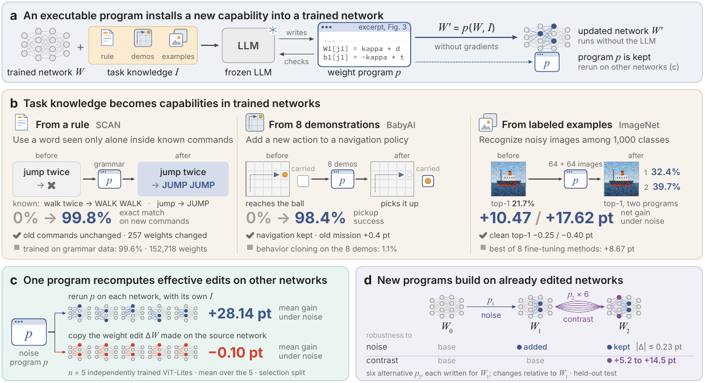

<h1 align="center">🧠 WeightCode</h1>

<h3 align="center">🧬 通过权重编程为神经网络安装新能力</h3>

<p align="center">
  <a href="README.md">English</a> · <b>简体中文</b>
</p>

<p align="center">
  <a href="https://gen-verse.github.io/WeightCode/"></a>
  <a href="#try-it"></a>
  <a href="#agent-skill"></a>
  <a href="assets/WeightCode.pdf"></a>
</p>

<p align="center">
  
  
  <a href="LICENSE"></a>
</p>

<p align="center">
  <a href="#what-we-achieved">🏆&nbsp;成果</a> ·
  <a href="#try-it">⚡&nbsp;立即试用</a> ·
  <a href="#agent-skill">🧩&nbsp;智能体技能</a> ·
  <a href="#how-it-works">⚙️&nbsp;工作原理</a> ·
  <a href="#quick-start">🚀&nbsp;更多检查</a> ·
  <a href="#run-the-experiments">🔬&nbsp;运行实验</a> ·
  <a href="https://huggingface.co/datasets/Boom5426/WeightCode">🤗&nbsp;数据</a> ·
  <a href="#repository-map">🗂️&nbsp;代码结构</a>
</p>

💡 **WeightCode 不经过梯度训练，就能为训练好的神经网络安装新能力。** 一个冻结的语言模型编写可执行的*权重程序*，
把一条规则、几条演示或少量标注样本变成新的权重。更新后的网络独立运行，同一个程序还能在其他网络上重新运行。
🧩 它以**智能体技能（agent skill）**的形式发布：⚡ [复制命令，在本地跑起来 ↓](#try-it)

<p align="center">
  <a href="assets/fig1.png"></a>
</p>

<a id="what-we-achieved"></a>

## 🏆 我们做到了什么

| | 发现 | 关键结果 |
| :--- | :--- | :--- |
| ✨ **安装新能力** | 一条规则、8 条演示或 64 + 64 张标注图像，就能变成网络原本没有的能力，原有行为得以保留。 | SCAN **0% → 99.8%** · BabyAI **0% → 98.4%** |
| 🛡️ **超越微调** | 给定相同的样本、检查次数和干净准确率约束，程序在 ImageNet 和 CIFAR-10 上都超过 8 种微调方法中最好的一种。 | ImageNet 噪声 **+10.47 / +17.62 pt**，微调为 +8.67 |
| 🔬 **机制可检验** | 安装进去的计算可以读懂，也可以检验：去掉噪声门控，增益随之消失。 | 去掉主门控后，净增益 **+31.75 → +10.05 pt** |
| ♻️ **可复用** | 不调用 LLM，把程序放到 5 个独立训练的网络上重新运行，它会为每个网络写出新的修改。直接复制权重修改则没有效果。 | 保留 **83–110%** 的增益 · 复制的修改 **−0.10 pt** |
| 🧱 **可接续** | 新程序可以在已经修改过的网络上继续安装能力，并保住先前的能力。 | 新增 **+5.2 至 +14.5 pt** · 原有能力变化在 **0.23 pt** 以内 |

📄 **[阅读论文](assets/WeightCode.pdf)**，查看完整的对比、机制分析和每一次会话。
🤗 **[在 Hugging Face 获取数据](https://huggingface.co/datasets/Boom5426/WeightCode)**。
📏 净增益等于新条件上的准确率变化加上干净准确率的变化，单位为百分点（pt）。
机制和复制修改的数字来自留出的分析集，其余来自留出的测试集。

<a id="try-it"></a>
<a id="install"></a>

## ⚡ 立即试用：大约两分钟复现论文的一个结果

🖥️ 只需要 **Linux x86-64** 和 [uv](https://docs.astral.sh/uv/)。不需要 GPU、API key、root 权限，也不需要配置沙箱。

```bash
git clone https://github.com/Gen-Verse/WeightCode.git && cd WeightCode
uv sync --locked
uv run weightcode reproduce scan
```

✅ 这条命令在不调用语言模型的情况下，重新运行论文里那个让 SCAN 序列模型学会在命令中使用 "jump" 的程序
（图 1b 左），然后在论文的留出测试命令上读出原网络和编辑后网络的表现。输出结尾如下：

```text
  SCAN: a rule becomes a capability (Figure 1b, left)
  Exact match on held-out test commands      before    after
    new commands with 'jump' (2,568)          0.0%    99.8%
    old commands (1,000)                     99.6%    99.6%
  Weights changed: 257 of 803,975
  Rebuilt network identical to the published one: yes (sha256 6c9bc3bdaf34)
  Paper: +99.81 pt on new commands, +0.00 pt on old ones, 257 weights changed -> reproduced exactly
```

🔍 它做了什么：

- 📥 从 [🤗 数据集](https://huggingface.co/datasets/Boom5426/WeightCode)下载训练好的网络、会话记录和程序（约 10 MB），
  并从 [SCAN 仓库](https://github.com/brendenlake/SCAN)下载论文所用提交版本的文本文件。每个文件都核对 sha256。
- 🧱 用 SCAN 的文件重建论文的测试划分，并核对它就是论文读取的那一份。
- ♻️ 重新运行程序，核对它构造出的编辑后网络与发布的网络逐位一致。
- 📏 在 2,568 条新命令和 1,000 条旧命令（均为留出数据）上读出原网络和编辑后网络的表现。

🫧 已发布的程序在核对 sha256 之后直接运行，不经过沙箱。加上 `--sandbox-python .venv-sandbox/bin/python`
就会改在 bubblewrap 里运行（[配置方法](#install-the-skill)）。如果网络受限，可以把 `HF_ENDPOINT` 设为 Hugging Face
镜像，并用 `--scan-dir` 指向本地的 SCAN 仓库副本。

<a id="agent-skill"></a>

## 🧩 智能体技能

🗣️ **告诉你的编程智能体，网络应该学会什么。你会拿回一个经过检验的模型、构造它的程序和一份报告。**
[`weightcode` 技能](skills/weightcode/SKILL.md)负责整个流程：导入你的检查点，绑定你的数据，在沙箱里复用或编写权重程序，
并且只有当更新在程序从未见过的数据上依然成立时才发布。

| 📥 你提供 | 🤖 智能体执行 | 📦 你得到 |
| :--- | :--- | :--- |
| 🧠 一个 FP32 的 torchvision ResNet-18 `state_dict` 及其类别列表<br>🗂️ 三个互不重叠的图像集：*experience*（程序可见）、*selection*（为候选打分）、*final*（只验证一次）<br>🎚️ 你能接受的干净准确率损失 | 🔍 兼容性检查与导入<br>♻️ **复用**已有程序，不调用语言模型<br>✍️ 用受控的 editor **合成**新程序（Claude Code，预算明确）<br>🏆 按固定规则选择，再做一次最终验证 | 🧠 `model.pt`：结果为 `accepted` 时是更新后的模型，否则是原模型<br>📝 程序包，可在其他检查点上重新运行<br>📋 `report.json`：`accepted`、`base-kept` 或 `final-rejected` |

<a id="install-the-skill"></a>

### 🛠️ 安装技能

🫧 这个技能会把每个程序（包括语言模型为你新写的程序）放进 [bubblewrap](https://github.com/containers/bubblewrap)
沙箱里运行：不能联网，也看不到你的 selection 和 final 数据。它需要 **Linux x86-64**、系统发行版自带的
**Python 3.14（位于 `/usr`）**，以及 **bubblewrap 0.11+**，路径为 `/usr/bin/bwrap`（Ubuntu 26.04 上运行
`sudo apt install bubblewrap`；Ubuntu 22.04 和 24.04 自带的版本较旧）。合成新程序还需要
[Claude Code](https://docs.anthropic.com/en/docs/claude-code)。

```bash
uv sync --locked --extra train --extra dev
bash scripts/setup_sandbox_venv.sh
mkdir -p ~/.claude/skills && cp -r skills/weightcode ~/.claude/skills/
uv run weightcode doctor --sandbox-python .venv-sandbox/bin/python
uv run python scripts/demo/skill_cli_walkthrough.py --root out/skill_cli
```

✅ 这几步会安装带 PyTorch 的引擎和只依赖 NumPy 的沙箱，为 Claude Code 安装技能，检查沙箱（输出 `"status": "ok"`），
再在一个小型合成项目上依次运行技能的全部命令，耗时约 40 秒。自带的示例程序对这个项目来说太弱，
所以运行以 `status: base-kept` 结束，也就是引擎保留了原模型。某一步失败时，请看[故障排查](#troubleshooting)。

💬 **然后在你自己的项目里打开 Claude Code，这样提出请求：**

```text
使用 $weightcode，在这些新条件样本上改进我的 ResNet-18，同时保持对干净图像的识别能力。
我的检查点是 model.pt，labels.json 给出类别顺序。我有相互独立的 experience、selection 和 final 三个图像文件夹。
干净准确率最多允许下降 1 个百分点。请先检查兼容性，并提出运行预算。
```

### ✅ 为什么可以信任返回的结果

- 🔒 **最终数据只评分一次**，而且是在选择结果写入只可写一次的文件之后。
- 🛡️ **不会悄悄变差。** 只有在 selection 集和 final 集上都达到你设定的阈值，更新才会发布。
  否则返回原模型，报告里会写明。
- 📏 **修改有上限。** 默认情况下，一个程序最多改动网络 5% 的权重，每个权重张量的变化不超过其范数的一半。
  程序在 🫧 bubblewrap 沙箱中运行，不能联网。
- ♻️ **可重放。** 保留下来的程序是一个文件。在相同输入上重新运行，会精确复现发布的权重。

### 🔌 其他智能体，以及你自己的模型

🤖 使用 Codex 的 skill installer：

```text
使用 $skill-installer 安装这个技能：
https://github.com/Gen-Verse/WeightCode/tree/main/skills/weightcode
```

📘 [命令详解](skills/weightcode/references/workflow.md)列出了在你自己的模型上使用的全部 `weightcode` 命令。
目前合成新程序要通过 Claude Code。Codex 可以操作这个技能，也可以复用程序。

<a id="how-it-works"></a>

## ⚙️ 工作原理

权重程序根据网络的权重 `W` 和任务知识 `I` 计算 **`W′ = p(W, I)`**：

1. 👀 **读。** editor 是一个冻结的语言模型，在只依赖 NumPy 的沙箱里工作，能看到网络权重、前向代码和任务知识 `I`。
   它可以运行网络，测量激活。
2. ✍️ **写。** 它编写一个 Python 程序，导出 `update(student, experience)`，返回 `{tensor_name: delta}`。
   框架按固定的修改上限校验这些增量，再把它们加到原始权重上。网络结构不变。
3. ✅ **检查。** 一次会话有 8 次检查。每次检查在一个 `I` 不包含的标注数据集上运行候选程序，返回两个计数：
   新条件输入中被修正的数量减去被弄错的数量，以及旧输入上的同一计数。
4. 🏆 **保留。** 程序按固定规则挑选：在旧检查输入上的损失不超过一个固定小比例的候选中
   （图像分类器为干净检查图像的 0.5%），选两个计数之和最高的那个。没有候选合格时，网络保持不变。
5. 🔁 **重跑。** 保留下来的程序是一个文件。在另一个兼容的网络上运行它，就能算出该网络的更新，不需要调用语言模型。

<a id="quick-start"></a>

## 🚀 更多检查

🎈 引擎和沙箱装好之后（见[安装技能](#install-the-skill)），这一节的所有内容都不需要下载数据集，也不需要 API key。

### ▶️ 1. 运行玩具示例

```bash
.venv/bin/python scripts/demo/toy_walkthrough.py --root out/toy_demo
```

这个示例在合成数据上构建六个很小的网络，在第一个网络上运行一次 editor 会话，保留选中的程序，再到另外五个网络上重新运行。
任务里预先埋入了一个修正，便于看清整个流程。它的增益展示的是机制，不代表基准性能。

耗时约 5 秒。输出的最后几行中会有这些内容（id 是随机的）：

```text
      check norm_flip.py: score_new +107, score_old +62, score +169
      final program: norm_flip.py (kind checked)
      condition rows: 160, accuracy change +69.38 points
```

📁 会话日志、选中的程序、网络读数和迁移记录都写在 `out/toy_demo/` 下。再运行一次时请换一个新的 `--root`。
示例还会打印一条 `--dry-run` 命令，用来查看真实会话的提示词。

### ⚡ 2. 逐步看懂技能的应用流程

```bash
uv run weightcode doctor --sandbox-python .venv-sandbox/bin/python
uv run python scripts/demo/skill_cli_walkthrough.py --root out/skill_cli
uv run python scripts/demo/skill_roundtrip.py --out out/skill_demo --sandbox-python .venv-sandbox/bin/python
```

- 🩺 沙箱可用时，`doctor` 输出 `"status": "ok"`。
- 🚶 walkthrough（约 40 秒）写出一个小型合成项目（`model.pt`、`labels.json` 和三个图像文件夹），并在上面逐条运行技能的复用命令。
  自带的示例程序对这个项目太弱，所以引擎保留原模型，报告 `status: base-kept`。
- 🔁 round trip（约 30 秒）用一个脚本化的 editor 驱动 editor 的 MCP 服务器，作用于两个独立初始化的 ResNet-18。
  它以 `"fixture_statuses": ["accepted", "accepted", "accepted"]` 和 `"exact_replay": true` 结束，
  并且重新运行时会为第二个网络写出不同的修改。

⚠️ 这两项检查都使用合成图像，检验的是引擎，不是识别质量。两者合计在 `out/` 下写入约 1.5 GB。
自带的 [`resnet18-ridge-head`](programs/resnet18-ridge-head/program.py) 示例是一个可复用的解析式分类头修正，
不是论文中的程序。

### 🧪 3. 检查安装

```bash
.venv/bin/python -m pytest -q \
  tests/test_patch_ops.py tests/test_patch_validation.py \
  tests/test_sandbox_isolation.py tests/test_sandbox_kernel.py \
  tests/test_harness_e2e.py tests/test_harness_e11.py tests/test_demo_toy_walkthrough.py \
  tests/test_application.py tests/test_skill_docs.py
```

✅ 预期结果：`233 passed`，约两分钟，没有 `skipped`。出现 skip 说明沙箱不可用（见下文）。

<a id="troubleshooting"></a>

<details>
<summary><strong>🩺 运行完整测试，排查沙箱问题</strong></summary>

用 `.venv/bin/python -m pytest -q` 运行全部测试（约 50 分钟）。部分检查需要外部数据集、已保存的会话或作者本地的研究记录，
缺少时会跳过。

| 问题 | 处理 |
| :--- | :--- |
| ⏭️ 沙箱测试被跳过 | 检查 `/usr/bin/bwrap`，然后运行 `bash scripts/setup_sandbox_venv.sh`。 |
| 🐍 沙箱解释器被拒绝 | 使用 `/usr` 下的发行版 Python。uv 管理的解释器和 conda 解释器不在沙箱的挂载范围内。 |
| 🫧 bubblewrap 报 namespace 或 uid-map 错误 | 确认主机允许非特权用户命名空间，并检查 `/usr/bin/bwrap`。 |
| 📦 沙箱环境已存在 | 安装脚本会保留它。直接使用现有环境，或用 `--target` 指定新位置。 |
| 📁 示例输出目录已存在 | 换一个新的 `--root`，已有记录会被保留。 |

</details>

<a id="run-the-experiments"></a>

## 🔬 运行实验

| 任务 | 入口 |
| :--- | :--- |
| 🗃️ 准备数据集和实例 | `scripts/prepare_data.py`、`scripts/build_instances.py` |
| 🏋️ 训练基础网络 | `scripts/train_base.py` |
| ✍️ 在 editor 会话中编写权重程序 | `scripts/run_editor_session.py` |
| ♻️ 在其他网络上重跑程序 | `scripts/run_program_transfer.py` |
| ⚖️ 运行微调和固定参照方法 | `scripts/run_fit_baselines.py`、`scripts/run_search_baselines.py` |
| 🧱 运行接续程序 | `scripts/run_program_stream.py` |

参数和各任务的选项见 `.venv/bin/python <entry-point> --help`。

<details>
<summary><strong>🗄️ 使用实验存储，或运行真实会话</strong></summary>

完整的数据集、训练好的检查点和会话记录不在本仓库中。🤗 数据在
[Hugging Face](https://huggingface.co/datasets/Boom5426/WeightCode)：

```bash
uvx --with click --from huggingface-hub==1.3.4 hf download Boom5426/WeightCode --repo-type dataset --local-dir weightcode-data
```

把下面三个变量指向已有的目录，或者从 [scripts/env.sh.example](scripts/env.sh.example) 开始。

```bash
export WEIGHTCODE_PRIVATE=/path/to/store/private
export WEIGHTCODE_SEALED=/path/to/store/sealed
export WEIGHTCODE_RUNS=/path/to/store/runs
```

`PRIVATE` 存放训练和验证数据、模型和实例，`SEALED` 存放测试数据和评估器状态，`RUNS` 存放会话和读数。
玩具存储请用 `source out/toy_demo/env.sh`。之前导出的记录必须使用当前的 `weightcode.*` 格式，
[命名空间迁移表](scripts/sealed/namespace_migration.json)保留了原始 manifest 的绑定关系。

真实会话需要 Claude Code CLI 和 API 凭据。先运行玩具示例打印出的 `--dry-run` 命令，再用 `--api-key-file` 传入凭据。
真实会话会消耗 API 额度，重新运行可能写出不同的程序。

</details>

<a id="repository-map"></a>

## 🗂️ 代码结构

| 路径 | 内容 |
| :--- | :--- |
| 🧠 [`weightcode/`](weightcode/) | 模型、数据、权重修改、沙箱、editor 框架、评估、参照方法和分析。 |
| 🛠️ [`weightcode/application/`](weightcode/application/) | 智能体技能背后的 `weightcode` 命令行工具。 |
| 🧩 [`skills/weightcode/`](skills/weightcode/) | 可安装的智能体技能及其命令详解。 |
| 📝 [`programs/`](programs/) | 可复用的权重程序示例。 |
| 📜 [`scripts/`](scripts/) | 示例脚本，以及数据、训练、会话、复用和接续程序的驱动脚本。 |
| 🧪 [`tests/`](tests/) | 基于合成存储的单元测试和集成测试。 |
| 📄 [`assets/`](assets/) | 论文（`WeightCode.pdf`）和图 1。 |
| 🌐 [`homepage/`](homepage/) | [项目主页](https://gen-verse.github.io/WeightCode/)，由 `.github/workflows/pages.yml` 部署到 GitHub Pages。 |
| 🤗 [Hugging Face 数据集](https://huggingface.co/datasets/Boom5426/WeightCode) | 数据，独立于本仓库托管。 |

## ⚖️ 许可证

代码以 [MIT 许可证](LICENSE) 发布。随附的第三方资源保留各自的许可证。
